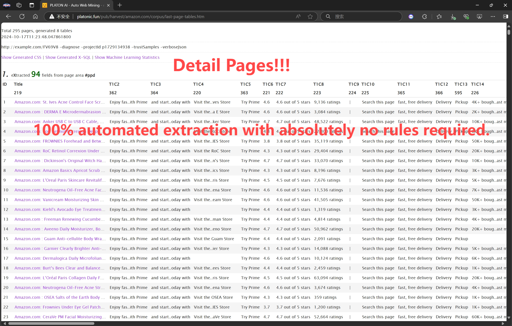

# 🚀 PulsarRPAPro

**English** | [简体中文](README-CN.md) | [中国镜像 🇨🇳](https://gitee.com/platonai_galaxyeye/exotic)

*全自动网页数据提取 —— 无需规则，只要结果！✨*

---

## 🌟 核心特性

PulsarRPAPro 提供：

* 👽 自动提取（AutoExtract）

    * 🏃‍♂️ 极速处理
    * 🎯 高精度识别
    * 🤖 基于机器学习，无需购买 Token！

* 🌐 网页界面（Web UI）

* ⌨️ 命令行界面（CLI）

PulsarRPA 内建能力：

* 🤖 **LLM 集成** —— 强大的大语言模型赋能自动化
* ⚡ **超高速执行** —— 协程安全浏览器控制，媲美爬虫性能
* 🧠 **网页理解能力** —— 深度解析动态内容
* 📊 **数据提取 API** —— 轻松提取结构化数据



---

## 🎥 演示视频

* **YouTube**：
  [](https://www.youtube.com/watch?v=qoXbnL4wdtc)

* **哔哩哔哩**：
  [https://www.bilibili.com/video/BV1Qg4y1d7kA](https://www.bilibili.com/video/BV1Qg4y1d7kA)

---

## 🚀 快速开始

### 📦 下载程序

下载最新的可执行 JAR 文件：

```bash
curl -L -o PulsarRPAPro.jar http://static.platonai.cn/repo/ai/platon/exotic/PulsarRPAPro.jar
```

### ⚙️ 运行前准备

确保 MongoDB 在 27017 端口运行，且**无需认证**：

   ```bash
   docker run -d --name mongodb -p 27017:27017 mongo:latest
   ```

---

## 📚 自动提取指南：结构化数据，无需编码，无需 Token！

使用 `harvest` 命令对商品列表页面进行无监督学习式的数据提取：

```bash
java -jar PulsarRPAPro.jar harvest "https://www.amazon.com/b?node=1292115011" -diagnose -refresh
```

> 💡 网址必须是入口页面，例如商品分类页或列表页。

工具将自动执行以下流程：

1. 访问入口页面
2. 识别最佳的商品详情页链接
3. 抓取这些页面
4. 自动进行分析提取

### 📄 示例结果

查看 HTML 格式的示例提取结果：
[Amazon 自动提取结果](docs/assets/amazon-harvest-result.html)

---

## 🖥️ 启动 PulsarRPAPro 服务

```bash
java -DDEEPSEEK_API_KEY=${DEEPSEEK_API_KEY} -jar PulsarRPAPro.jar serve
```

---

## 🧠 LLM 智能操作：只需文字，无需代码！

直接用自然语言控制浏览器行为：

```bash
curl -X POST "http://localhost:8582/api/ai/command" \
  -H "Content-Type: text/plain" \
  -d '
    访问 https://www.amazon.com/dp/B0C1H26C46
    总结该商品信息。
    提取：商品名称、价格、评分。
    找出所有包含 /dp/ 的链接。
    页面加载后：点击 #title，然后滚动到中间。
  '
```

---

## 🔍 LLM + X-SQL：既简单又强大

```bash
curl -X POST "http://localhost:8582/api/x/e" -H "Content-Type: text/plain" -d "
select
  llm_extract(dom, 'product name, price, ratings') as llm_extracted_data,
  dom_base_uri(dom) as url,
  dom_first_text(dom, '#productTitle') as title,
  dom_first_slim_html(dom, 'img:expr(width > 400)') as img
from load_and_select('https://www.amazon.com/dp/B0C1H26C46', 'body');
"
```

🔎 示例输出：

```json
{
  "llm_extracted_data": {
    "product name": "Apple iPhone 15 Pro Max",
    "price": "$1,199.00",
    "ratings": "4.5 out of 5 stars"
  },
  "url": "https://www.amazon.com/dp/B0C1H26C46",
  "title": "Apple iPhone 15 Pro Max",
  "img": ""
}
```

---

## 🔧 代理设置

代理为**可选配置**。设置环境变量：

```bash
export PROXY_ROTATION_URL=https://your-proxy-provider.com/rotation-endpoint
```

此 URL 每次访问应返回一个或多个新的代理 IP。

---

## 📞 联系我们

* 💬 **微信**：galaxyeye
* 🌐 **微博**：[galaxyeye](https://weibo.com/galaxyeye)
* 📧 **邮箱**：[galaxyeye@live.cn](mailto:galaxyeye@live.cn)，[ivincent.zhang@gmail.com](mailto:ivincent.zhang@gmail.com)
* 🐦 **Twitter**：[@galaxyeye8](https://twitter.com/galaxyeye8)
* 🌍 **官网**：[platon.ai](https://platon.ai)

<div style="display: flex;">
  
</div>
